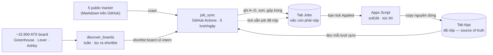

# Internship Sheet Sync

Đọc các public GitHub internship tracker **và job board ATS của chính công ty**
(Greenhouse, Lever, Ashby), giữ lại role SWE liên quan, gộp các bản trùng của cùng một
posting, rồi append vào tab `Jobs` của một Google Sheet. Tick một ô checkbox
là dòng đó tự sang tab `App`; ngược lại, những job đã nộp rồi thì tự được tick sẵn.

Không browser automation, không database, không AI, không queue, không web dashboard.
Một Python package, một GitHub Actions workflow, hai file Apps Script.



Điều bất biến của cả hệ: **`App` là source of truth và không bao giờ bị ghi đè.** Mọi thứ
chỉ chảy vào nó, không có chiều ngược lại.

## Bắt đầu từ đâu

| Bạn là | Đọc |
|---|---|
| Muốn dựng lại từ đầu | [docs/setup.md](docs/setup.md) |
| Dùng sheet hàng ngày, muốn biết mỗi cột nghĩa là gì | [docs/spreadsheet.md](docs/spreadsheet.md) |
| Thắc mắc vì sao hai dòng bị gộp, hoặc vì sao một job không được tick | [docs/matching.md](docs/matching.md) |
| Muốn biết job từ đâu ra và khi nào một dòng bị xoá | [docs/crawling.md](docs/crawling.md) |
| Muốn biết đơn nào có alumni hoặc recruiter để xin referral | [docs/alumni.md](docs/alumni.md) |
| Đang vận hành: soát lỗi, đọc log, rebuild | [docs/operations.md](docs/operations.md) |

## Chạy thử nhanh

```bash
uv venv && uv pip install -e .
set -a; source .env; set +a     # theo .env.example
internship-sync
```

Cần một Google service account đã được share quyền vào spreadsheet. Chi tiết ở
[docs/setup.md](docs/setup.md).

## Bố cục repo

```
job_sync/          Python package
  main.py          CLI, cửa sổ giờ chạy, in kết quả
  sources.py       fetch + parse tracker, normalize link, chuẩn hoá tên role
  boards.py        hỏi job board Greenhouse / Lever / Ashby
  roles.py         regex quyết định role nào được giữ
  places.py        đọc location, quyết định job có ở Mỹ không
  sheet.py         đọc/ghi Google Sheet, gộp trùng, tick Applied, audit
  liveness.py      hỏi từng board xem posting còn mở không
  highlight.py     tick hai cột Alumni/Recruiter ở App, tô vàng dòng ở Alumni
  data/            danh sách công ty có recruiter + shortlist ATS board
apps_script/       chạy phía Google, dán vào Apps Script editor
scripts/           chạy tay: dựng lại các file trong data/
sources.toml       danh sách tracker
tests/             pytest
```
