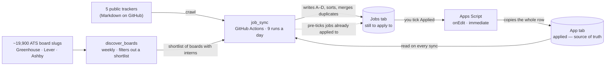

# Internship Sheet Sync

Reads the public GitHub internship trackers **and the ATS job boards the companies
themselves run** (Greenhouse, Lever, Ashby), keeps the SWE roles that are relevant, merges
the duplicate copies of one posting, then appends them to the `Jobs` tab of a Google Sheet.
Tick one checkbox and the row moves itself to the `App` tab; the other way round, a job
already applied to is ticked for you.

For a job you found outside those trackers, the included personal Chrome extension can add
Company, Role and the current page link directly to `App`; it fills the property number,
date and initial status. See [docs/external-applications.md](docs/external-applications.md).

No browser automation, no database, no AI, no queue, no web dashboard. One Python package,
two GitHub Actions workflows, two Apps Script files.



The invariant of the whole system: **`App` is the source of truth and is never overwritten.**
Everything only flows into it; there is no flow the other way.

## Where to start

| You are | Read |
|---|---|
| Wanting to rebuild from scratch | [docs/setup.md](docs/setup.md) |
| Using the sheet day to day, wanting to know what each column means | [docs/spreadsheet.md](docs/spreadsheet.md) |
| Wondering why two rows were merged, or why a job was not ticked | [docs/matching.md](docs/matching.md) |
| Wanting to know where a job came from and when a row is deleted | [docs/crawling.md](docs/crawling.md) |
| Wanting to know which application has an alumnus or a recruiter to ask for a referral | [docs/alumni.md](docs/alumni.md) |
| Operating it: auditing, reading the log, rebuilding | [docs/operations.md](docs/operations.md) |

## A quick try

```bash
uv venv && uv pip install -e .
set -a; source .env; set +a     # following .env.example
internship-sync
```

Needs a Google service account that has been shared into the spreadsheet. Details in
[docs/setup.md](docs/setup.md).

## Repo layout

```
job_sync/          Python package
  main.py          CLI, the run-time window, prints the results
  sources.py       fetch + parse the trackers, normalize links, canonicalise role names
  boards.py        asks the Greenhouse / Lever / Ashby job boards
  roles.py         the regexes that decide which roles are kept
  places.py        reads the location, decides whether a job is in the US
  sheet.py         reads/writes the Google Sheet, merges duplicates, ticks Applied, audits
  liveness.py      asks each board whether its posting is still open
  highlight.py     ticks the two Alumni/Recruiter columns on App, paints rows yellow on Alumni
  data/            the list of companies with recruiters + the ATS board shortlist
apps_script/       runs on Google's side, pasted into the Apps Script editor
scripts/           run by hand: rebuild the files in data/
sources.toml       the list of trackers
tests/             pytest
```
