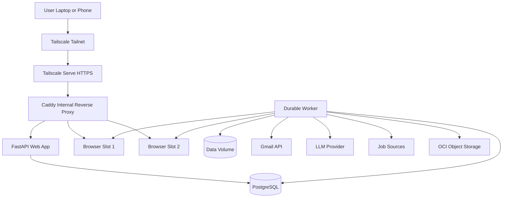

# 10. System Architecture

## 10.1 Logical architecture



## 10.2 Deployment architecture

One OCI VM runs:

```text
Host OS
├── tailscaled
├── Docker Engine
├── Docker Compose
└── /data mounted block volume
    ├── postgres/
    ├── artifacts/
    ├── browser-profiles/
    ├── browser-sessions/
    ├── backups/
    └── logs/
```

Docker services:

```text
caddy
web
worker
postgres
browser-slot-1
browser-slot-2
```

Optional development-only services:

```text
mailpit
fake-ats
```

## 10.3 Why fixed browser slots

A dynamic container-per-application architecture is flexible but unnecessarily complex for one user.

Two fixed slots provide:

- predictable RAM use;
- fixed internal ports;
- simple noVNC routing;
- easier health checks;
- fewer orphan containers;
- persistent browser profiles;
- straightforward replay.

The queue may hold 10 applications, but only two occupy live browser slots.

---
