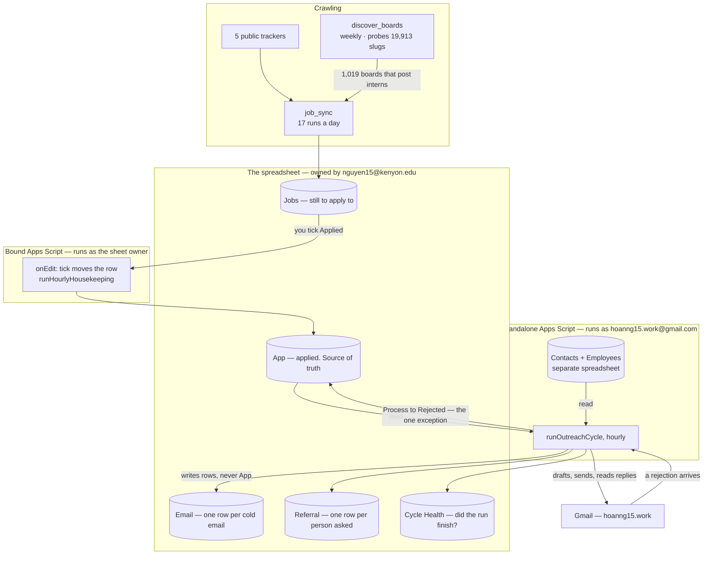

# The whole thing, end to end

One page for whoever takes this over. Every rule below is argued properly somewhere else; this is
the map that says which document to open. For what each source file and function does, see
[components/](components/README.md).

## What it is

A job hunt run out of one Google Sheet. Postings are crawled in, you tick a box to say you
applied, and a few days later the system writes on your behalf — to a recruiter at that company,
and to an engineer there for a referral — politely, slowly, and stopping the moment somebody
replies or says no.

One Python package, two Apps Script projects, one spreadsheet, all inside free tiers.



## The three identities, which explain most of the design

| Who | Does |
|---|---|
| a Google **service account** | the Python crawler writes `Jobs` with it |
| **nguyen15@kenyon.edu** | owns the spreadsheet, so it owns the *bound* Apps Script |
| **hoanng15.work@gmail.com** | owns the *standalone* Apps Script, and is the address every email is sent from |

The second and third are why there are two Apps Script projects. **A bound script runs as whoever
owns the spreadsheet**, so `GmailApp.sendEmail` inside it would send from the Kenyon address — the
one that must never appear as the sender. The sender therefore has to be a separate project owned
by the sending account, with the sheet shared into it.

Everything else follows: the sending account's own mailbox already holds the replies, bounces and
rejections, so reading them needs no extra credential and no stored token.

## The moving parts

| Part | Where it runs | How often | Cost |
|---|---|---|---|
| `job_sync` (Python) | GitHub Actions, dispatched from **cron-job.org** | 17 runs a day, every 45 min 09:00–21:00 ET | ~1.7 min a run, billed rounded to 2 |
| `discover_boards` (Python) | GitHub Actions | Sunday 06:00 UTC | rebuilds the 1,019-board shortlist |
| `sync_applied_to_app.gs` | bound Apps Script | every edit, plus an hourly sweep | free, no quota |
| `outreach/*.gs` | standalone Apps Script | one hourly trigger | free, no Actions minutes |
| Chrome side panel | your browser | when you use it | free |

`sync.yml` has **no `schedule:` of its own**. GitHub delivered its cron firings a median 25 minutes
late over 21–27 August 2026 — p90 74, worst 106 — which a 45-minute cadence cannot absorb. The
clock lives at cron-job.org, created by `scripts/setup_cron_job_org.sh`, and a dispatch starts at once.

The outreach half is Apps Script rather than an Actions worker for a reason worth keeping: Actions
bills wall-clock, so the jitter between two emails would be *paid for*. Apps Script triggers cost
nothing, need no OAuth refresh token, and get reply detection for free by being inside the mailbox.

## One firing, eighteen steps

`runOutreachCycle` runs hourly. Every step is isolated — `step(name, work)` catches per step, so a
Gmail search that throws in step 2 does not take step 12 with it.

```
schema migration                                   ← OUTSIDE the isolation; fatal by design
health stamp: started
layout · scan · rejections · stale
referralScan · referralReplanned · referralPlanned · referralSent · referralDrafted
queued · sent · written
followUpPlanned · followUpSent
projected · season · sorted · referralSorted
health stamp: finished
```

Three orderings are load-bearing:

- **Send before write** (`sent` before `written`, `referralSent` before `referralDrafted`), or a
  message could be written and sent inside one firing and the hour in which it could have been
  read would never exist.
- **Rejections before enqueue**, or a rejection read now would have a fresh attempt opened under it.
- **`referralScan` before `referralReplanned`**, because the replan closes the rest of a group
  somebody answered and can only close what the scan has marked.

The health stamp is written **before** the fatal schema step. A run that dies part way leaves a row
on `Cycle Health` that says it started and never says it finished — the only record such a death
leaves behind.

## Three paths, one mailbox

`DAILY_EMAIL_BUDGET = 45` across everything. `EMAIL_PATH_ORDER = referral → cold → followup`: a
path reserves against everything below it and subtracts everything above it.

| | Cold email | Referral | Follow-up |
|---|---|---|---|
| Asks | a recruiter to look at an application | an engineer for a referral | the same recruiter again, on the same thread |
| Starts from | an `App` row | an `App` row | a sent cold email |
| Per day | `[0,15,25,22,18,10,0]` Sun→Sat | 14 | 6 |
| Per company | 5 per rolling 7 days | **1 per day**, 6 ever | — |
| Per application | 3 at once, one day apart; 14 days of silence opens the next 3 | — | one |
| Hours | 09:00–17:00, nine firings | 06:00–19:00, weekdays only | 08:00–19:00 |
| Order | ticked first, then employers take turns, oldest application first | ticked first, then employers take turns | by window |

Referral leads because it is the scarcest: six people per employer and **no second attempt ever**,
so an ask that loses its place is one of six chances spent on nothing. Follow-up trails because it
is the only path that loses nothing by slipping a day.

## The rules that decide who gets written to

| | |
|---|---|
| Qualifies | an `App` row at `Process` of `Applied` or `Completed OA`, 2+ days old, with someone to write to |
| Review window | every message sits in `Drafts` for one hour; **deleting the draft cancels the send** |
| What stops it | a reply, a rejection, `Process` leaving the qualifying set, or a `Cancel` tick |
| A tick moves the whole ask | `Priority` and `Cancel` expand to every row at that company and role — six people are one decision |
| Kill switch | `removeOutreachTriggers`, and it is the only one |

## Testing

Everything that *decides* is a pure function over rows and a date, so the rules can be argued with
on a laptop with no Google account and no risk of sending anything:

```bash
node apps_script/harness.js && node apps_script/outreach/harness.js && pytest -q
```

387 and 570 assertions respectively. **A passing harness says the rules are right. It says nothing
about whether they ran against the sheet** — that is what `Cycle Health` and `outreach_diag.gs`
are for, and the gap between the two cost weeks once already.

## Invariants — break these and the system lies

1. **`App` is the source of truth and is never overwritten.** Everything flows into it. The single
   exception is a recognised rejection writing `Process`, and it appends the matching `Update` line
   by hand because `onEdit` does not fire for another script's write.
2. **`FINGERPRINT_SALT` never changes.** The `Email` tab identifies a recruiter only by an HMAC of
   their address. Change the salt and every person ever contacted looks uncontacted again.
3. **No recruiter name, address or message body ever enters the tracker spreadsheet.** They live
   only in the contacts spreadsheet owned by the sending account.
4. **A row is never deleted from `Jobs` by the loosest matching layer.** See [matching.md](matching.md).
5. **A person is asked for a referral once, ever.** Cancelled rows still count as asked.
6. **`docs/seed_recruiters.csv` is gitignored and stays that way.**

## When something looks wrong

| Symptom | Look at |
|---|---|
| the tab did not change though the fix is deployed | `Cycle Health`: does the last row say `ok`, or is it stuck on `running`? |
| the editor and the repo disagree | pull into a **scratch directory** and diff; never into the repo |
| a rejection was missed after the rules improved | bump `REJECTION_RULES_VERSION`; the next firing reopens the last 45 days |
| an application closed that should not have | the `Tracker/Rejected` label in Gmail; every closure is one thread in it |
| nothing is sending | weekend? `DAILY_CAP` is 0 Sat/Sun and the referral path skips weekends. Then: is the trigger installed? |
| everything queued, nothing drafted | drafting runs 09:00–16:00 ET; 17:00 only sends |
| referral rows clustered by company | the replan is not reaching the sheet — see [components/outreach-diagnostics.md](components/outreach-diagnostics.md) |
| `Access denied: DriveApp` | scopes are inferred at Allow-time — re-authorise; `appsscript.json` lists them |
| a row has no `Scheduled At` | its `Date Applied` is probably in the future; the year is a typo |
| `UNLOGGED` in `--audit-app` | `Process` changed without a matching last line in `Update` |
| threads in `Tracker/Check by hand` | working as designed — a rejection that could not be pinned to one application |

## The deeper documents

| | |
|---|---|
| [components/](components/README.md) | **one document per source file** — what it owns, what it connects to, every function |
| [setup.md](setup.md) | rebuilding from scratch: service account, `.env`, secrets, both scripts |
| [spreadsheet.md](spreadsheet.md) | every column of every tab, and who may write where |
| [outreach.md](outreach.md) | the email system in full: the caps, the message, the rejection matcher |
| [matching.md](matching.md) | when two rows are one job |
| [crawling.md](crawling.md) | the sources, the role filter, the only three reasons a row disappears |
| [operations.md](operations.md) | reading the log, `--audit-app`, `--rebuild`, the error table |
