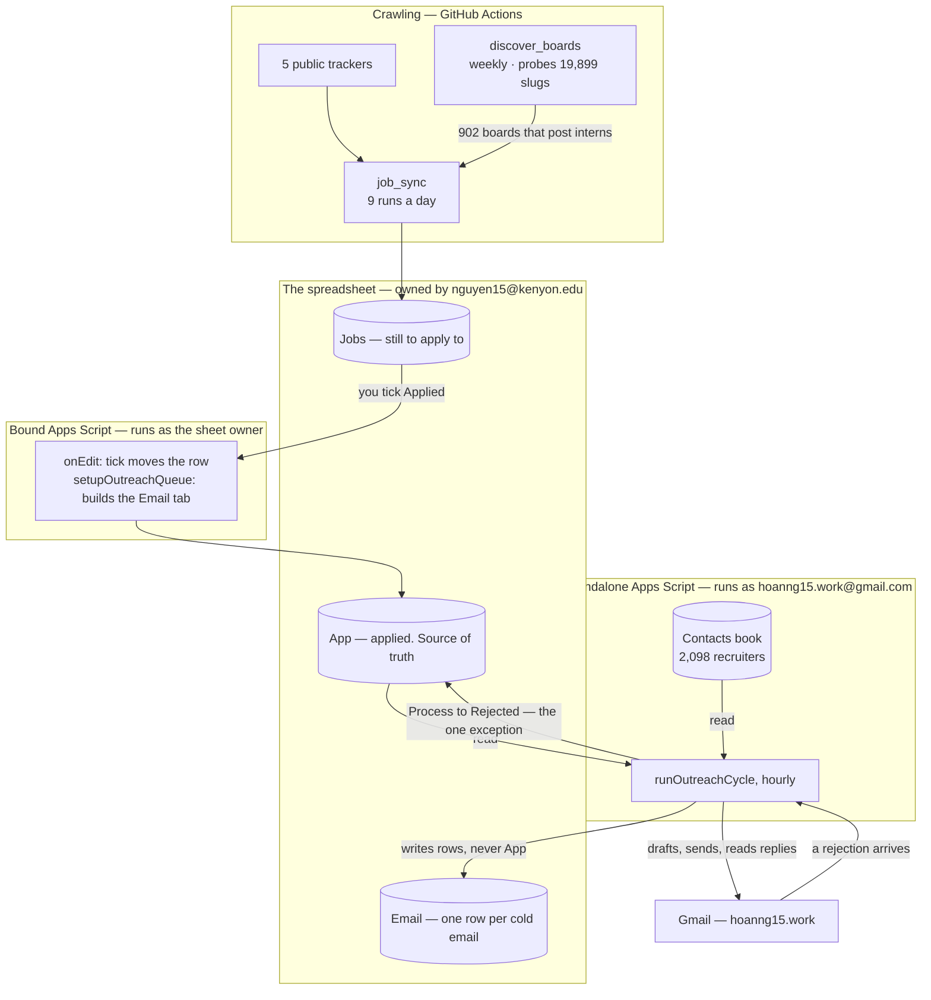

# The whole thing, end to end

One page for whoever takes this over. Every rule below is argued properly somewhere else; this
is the map that says which document to open.

## What it is

A job hunt run out of one Google Sheet. Postings are crawled in, you tick a box to say you
applied, and a few days later the system emails a recruiter at that company on your behalf —
politely, slowly, and stopping the moment the company says no.

Nothing here is a product. It is one Python package, two Apps Script projects and one
spreadsheet, all inside free tiers.



## The three identities, which explain most of the design

| Who | Does |
|---|---|
| a Google **service account** | the Python crawler writes `Jobs` with it |
| **nguyen15@kenyon.edu** | owns the spreadsheet, so it owns the *bound* Apps Script |
| **hoanng15.work@gmail.com** | owns the *standalone* Apps Script, and is the address every cold email is sent from |

The second and third are why there are two Apps Script projects instead of one. **A bound script
runs as whoever owns the spreadsheet**, so `GmailApp.sendEmail` inside it would send from the
Kenyon address — the one that must never appear as the sender. The sender therefore has to be a
separate project owned by the sending account, with the sheet shared into it.

Everything else follows: the sending account's own mailbox is where replies, bounces and
rejections already are, so reading them needs no extra credential and no token stored anywhere.

## The four moving parts

| Part | Where it runs | How often | Cost |
|---|---|---|---|
| `job_sync` (Python) | GitHub Actions | 9 runs a day | ~1,080 of 2,000 free minutes/month |
| `discover_boards` (Python) | GitHub Actions | Sunday 06:00 UTC | rebuilds the 902-board shortlist |
| `sync_applied_to_app.gs` | bound Apps Script | on every edit | free, no quota |
| `outreach/*.gs` | standalone Apps Script | 1 trigger, hourly | free, no Actions minutes |
| Chrome side panel | your browser | when you use it | free |

The outreach half is Apps Script and not a GitHub Actions worker for a reason worth keeping:
Actions bills wall-clock, so the jitter between two emails would be *paid for*, and at 25 emails
a day the budget does not survive. Apps Script triggers cost nothing, need no OAuth refresh
token, and get reply detection for free because they are already inside the mailbox.

## One firing, six steps

`runOutreachCycle` runs every hour and does the whole round in dependency order:

1. **what came back** — replies and bounces on messages sent in the last 30 days
2. **who said no** — rejections in the mailbox → `App.Process = Rejected`, and any draft already
   written for that application is deleted from Gmail
3. **what is new** — applications ticked `Applied` since the last firing become queued rows
4. **what goes out** — the drafts written an hour ago, unless you deleted one in the meantime
5. **what is written** — this hour's share of the day's cap, into `Drafts`, to sit for an hour
6. **what happens next** — `Drafted At` and `Scheduled At` recomputed across everything queued

Two orderings are load-bearing. **Step 4 before step 5**, or a message could be written and sent
inside one firing and the hour in which it could have been read would never exist. **Step 2
before step 3**, or a rejection read now would have a fresh attempt opened underneath it.

## The rules, in one table

| | |
|---|---|
| Who gets emailed | an `App` row at `Process = Applied`, 2+ days old, with a contact at that company |
| In what order | **oldest application first** — email value decays with age; that is the only sort key |
| How many a day | `[0, 15, 25, 22, 18, 10, 0]` Sun→Sat, spread over eight firings, never burned at 09:00 |
| How many per company | 5 per rolling 7 days, counting queued and drafted rows, not just sent ones |
| How many per application | 3 at once, one day apart; 14 days of silence opens the next 3 |
| What stops it | a reply before the next wave, a rejection, or `Process` leaving `Applied` |
| Review window | every email sits in `Drafts` for one hour; **deleting the draft cancels the send** |
| Kill switch | `removeOutreachTriggers`, and it is the only one |

## What lives where

```
job_sync/                    crawling, matching, writing Jobs
apps_script/
  sync_applied_to_app.gs     the bound script: onEdit, setupAppColumns, setupOutreachQueue
  harness.js                 62 tests
  outreach/                  the standalone sender project
    outreach_config.gs       IDs, column numbers, caps, date helpers
    outreach_contacts.gs     the contacts book, and what counts as one employer
    outreach_compose.gs      ten message variants and the HTML builder
    outreach_queue.gs        who earns a row, in what order, how many this hour
    outreach_send.gs         drafting, sending, replies, bounces, the trigger
    outreach_rejections.gs   recognising a rejection and closing the application
    harness.js               164 tests
```

Everything that *decides* is a pure function over rows and a date, so the rules can be argued
with on a laptop with no Google account and no risk of sending anything:

```bash
node apps_script/harness.js && node apps_script/outreach/harness.js && pytest -q
```

## Invariants — break these and the system lies

1. **`App` is the source of truth and is never overwritten.** Everything flows into it. The
   single exception is a recognised rejection writing `Process`, and it appends the matching
   `Update` line by hand because `onEdit` does not fire for another script's write.
2. **`FINGERPRINT_SALT` never changes.** The `Email` tab identifies a recruiter only by an HMAC
   of their address. Change the salt and every person ever contacted looks uncontacted again.
3. **No recruiter name, address or message body ever enters the tracker spreadsheet.** They live
   only in the contacts book owned by the sending account.
4. **A row is never deleted from `Jobs` by the loosest matching layer.** See `matching.md`.
5. **`docs/seed_recruiters.csv` is gitignored and stays that way.**

## When something looks wrong

| Symptom | Look at |
|---|---|
| the editor and the repo disagree | you pasted. Use `clasp push` — see `apps_script/outreach/README.md` |
| a rejection was missed after the rules improved | bump `REJECTION_RULES_VERSION`; the next firing reopens the last 45 days |
| an application closed that should not have | open the `Tracker/Rejected` label in Gmail; every closure is one thread in it |
| nothing is sending | is it a weekend? `DAILY_CAP` is 0 Sat/Sun. Then: is the trigger installed? |
| everything queued, nothing drafted | the firing runs 09:00–16:00 ET; 17:00 only sends |
| `Access denied: DriveApp` | scopes are inferred at Allow-time — re-authorise, `appsscript.json` lists them |
| a row has no `Scheduled At` | its `Date Applied` is probably in the future; the year is a typo |
| `UNLOGGED` in `--audit-app` | `Process` changed without a matching last line in `Update` |
| threads piling up in `Tracker/Check by hand` | working as designed — a rejection that could not be pinned to one application |

## The deeper documents

| | |
|---|---|
| [setup.md](setup.md) | rebuilding from scratch: service account, `.env`, secrets, installing both scripts |
| [spreadsheet.md](spreadsheet.md) | every column of every tab, and who may write where |
| [outreach.md](outreach.md) | the cold email system in full: the caps, the message, the rejection matcher |
| [matching.md](matching.md) | when two rows are one job |
| [crawling.md](crawling.md) | the sources, the role filter, the only three reasons a row disappears |
| [operations.md](operations.md) | reading the log, `--audit-app`, `--rebuild`, the error table |
